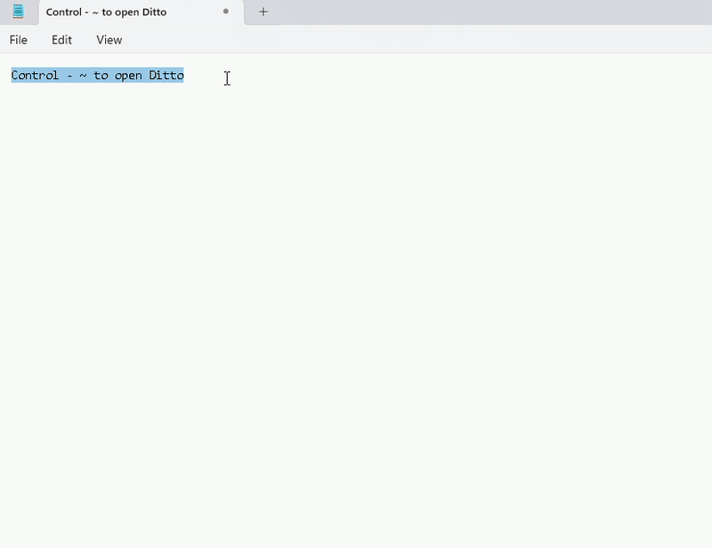

# [Ditto - 剪贴板管理器](https://github.com/sabrogden/Ditto/releases/download/3.25.113.0/DittoSetup_3_25_113_0.exe)

  

---

**[English](#ditto---clipboard-manager)** | **[中文](#ditto---剪贴板管理器)**

---

# Ditto - Clipboard Manager

---

## 基本用法

1. 运行 Ditto
2. 复制内容到剪贴板，例如在文本编辑器中选中文字后按 Ctrl+C
3. 点击系统托盘中的 Ditto 图标，或按下默认快捷键 `Ctrl + ``（反引号键）打开 Ditto
4. 双击或按回车键将选中的内容粘贴到之前的窗口

## 本地优先
- ✅ 无需登录
- ✅ 无云端依赖
- ✅ 无遥测数据

## ☁️ 云端同步与 Web 管理面板（新功能！）

Ditto 现在支持**云端同步**和基于 Web 的管理面板，实现跨设备剪贴板管理！

### 特性
- ✅ **多设备同步** - 在设备间无缝同步剪贴板内容
- ✅ **Web 管理面板** - 从任何浏览器查看、搜索和管理剪贴板
- ✅ **端到端加密** - AES-256-GCM 加密保护您的数据隐私
- ✅ **实时同步** - 基于 WebSocket 的设备间即时同步
- ✅ **自托管** - 通过 Docker 部署，完全掌控您的数据

### 快速开始云端部署

```bash
# 1. 克隆仓库
git clone https://github.com/sabrogden/Ditto.git
cd Ditto

# 2. 配置环境
cp .env.example .env
JWT_SECRET=$(openssl rand -base64 32)
sed -i "s/change-me-in-production/$JWT_SECRET/" .env

# 3. 启动后端服务
docker-compose up -d

# 4. 启动前端（开发模式）
cd web && npm install && npm run dev

# 5. 访问服务
# 前端: http://localhost:5173（Vite 默认端口）
# 后端 API: http://localhost:8080
# 健康检查: http://localhost:8080/health
```

生产环境部署（HTTPS）：
```bash
# 生成 SSL 证书
./generate-certs.sh "your-domain.com"

# 配置 JWT 密钥
echo "JWT_SECRET=$(openssl rand -base64 32)" > .env

# 启动后端（生产模式，单容器统一输出 API + 前端静态文件）
docker-compose -f docker-compose.prod.yml up -d

# 访问服务: https://localhost
```

📖 **完整文档：**
- [云端部署指南](docs/DEPLOYMENT_GUIDE.md)
- [云端服务器架构](docs/PROJECT_PLAN.md)
- [云端部署详解](docs/CLOUD_DEPLOYMENT.md)

### 技术栈
- **后端:** Go + SQLite3/PostgreSQL + WebSocket
- **前端:** Vue 3 + Vite + Pinia
- **加密:** AES-256-GCM 端到端加密
- **部署:** Docker Compose + Nginx (TLS)
- **监控:** Prometheus + Grafana + ELK

## 🔍 OCR 文字识别插件

Ditto 内置 OCR（光学字符识别）插件，可从剪贴板图片中提取文字。

### 特性
- ✅ **图片文字识别** - 自动检测剪贴板中的图片并提取文字
- ✅ **排版保留** - 按阅读顺序排序识别结果，自动插入换行和空格
- ✅ **纯文本粘贴** - OCR 结果写入数据表，粘贴纯文本即可获取识别内容
- ✅ **本地推理** - 基于 ONNX Runtime 1.27.1 + OpenCV 4.14.0，无需联网

### 依赖版本
- ONNX Runtime: v1.27.1（静态库构建）
- OpenCV: v4.14.0
- 模型文件通过 GitHub Releases 自动下载

📖 **构建详情：** 参见 `scripts/build-onnxruntime.bat`、`scripts/download-ocr-deps.bat`

## 🚀 相对上游新增功能

本分支在 [sabrogden/Ditto](https://github.com/sabrogden/Ditto) 基础上新增以下能力：

### 🖥️ OCR 命令行工具 (OcrCli)
独立命令行工具，经 `OcrDll.dll` 调用 PP-OCRv6 引擎识别图片文字，便于脚本与 CI 集成。

```bash
OcrCli.exe <image1> [image2 ...] [-m <dir>] [-o <file>] [-d <path>] [-j|--json] [-q|--quiet]
```

- `-j/--json` — JSON 数组输出（`file/text/success/error` 字段），供程序化调用
- `-q/--quiet` — 抑制 stderr 诊断输出
- 环境变量 `OCR_CLI_MODELS_DIR`、`OCR_CLI_DLL_PATH` 可覆盖默认路径
- 返回值 `0` 全部成功 / `1` 部分或全部失败
- 源码 `tools/OcrCli/`，使用说明 `tools/OcrCli/README.txt`

### 🔐 凭据 DPAPI 保护
云令牌、加密密钥与网络密码经 Windows DPAPI 加密后落盘（`src/shared/SecureStore.h`）；旧明文凭据下次写入时自动升级为 `DPAPI:` 前缀密文。

### 🗄️ 本地数据库加密（可选）
基于 `sqlite3_key` 的本地库加密基础设施，默认关闭；注册表开启，随机密钥由 DPAPI 保护。

### 🔄 云同步令牌自动刷新
服务端 access token 缩至 15 分钟后，客户端自动调 `/auth/refresh` 无感续期（`CloudAuth::TryRefreshToken`），不再频繁弹出重新登录提示。

### 💻 按安装设备标识
登录时上报本机安装标识，每台安装对应服务端独立设备行，多设备可区分管理。

### ⌨️ 粘贴为图像快捷键
新增默认快捷键 `Shift + \`（`VK_OEM_5 + HOTKEYF_SHIFT`），并修复 PowerPoint 等场景优先取 OCR 文本的问题。

### 🤖 GitHub Actions CI/CD
`.github/workflows/` 提供多套工作流：`ci`、`build-onnxruntime`、`build-opencv`、`build-ocr-cli`（云编译 OcrCli）、`client-build-portable-legacy`、`publish-image`（容器镜像发布）。

## 📁 项目结构

```
Ditto/
├── .github/workflows/      # GitHub Actions CI/CD (ci, onnxruntime, opencv, ocr-cli, portable, publish-image)
├── src/                    # Ditto 主程序 (C++/MFC)
│   ├── CloudSync/          # 云端同步客户端模块
│   ├── ClipboardOCR.cpp    # OCR 集成入口
│   ├── shared/             # 共享头文件 (SecureStore.h DPAPI 凭据保护)
│   └── ...                 # 核心模块 (Clip, Options, QListCtrl 等)
├── Addins/
│   ├── DittoOCR/           # OCR 插件 (ONNX Runtime + OpenCV)
│   └── DittoUtil/          # 工具插件
├── server/                 # 云端后端 (Go)
│   ├── cmd/                # 入口 (server, cli)
│   ├── internal/           # handler, service, model, hub, middleware
│   ├── pkg/crypto/         # 加密库
│   └── migrations/         # 数据库迁移
├── web/                    # Web 管理面板 (Vue 3 + Vite)
│   └── src/views/          # admin, Clips, Dashboard, DashboardHome, Devices,
│                           # Groups, Login, NotFound, Settings, SyncLogs
├── docker/                 # Docker Compose 配置
├── scripts/                # 构建脚本 (ONNX, OCR 依赖, 证书生成, E2E 测试)
├── docs/                   # 文档 (部署指南、架构设计、测试报告)
└── tools/                  # 辅助工具
    ├── CloudSync_Test/     # C++ 云端同步单元测试
    ├── EncryptDecrypt/     # 加密解密工具
    ├── OcrCli/             # OCR 命令行工具
    ├── FocusHighlight/     # 焦点高亮工具
    ├── ICU_Loader/         # ICU 加载器
    ├── U3Stop/             # U3 停止工具
    └── focusdll/           # 焦点 DLL
```

## 🧪 测试

| 测试项目 | 语言 | 覆盖范围 |
|----------|------|----------|
| CloudSync_Test | C++ | 加密、认证、同步、CRC32、MD5、SHA2、正则、拼音转换 |
| server/tests/ | Go | 认证、剪贴板 CRUD、设备、加密、群组、统计、WebSocket、限流 |
| web/tests/ | JavaScript | E2E (认证、剪贴板、群组、同步日志、导航) |
| web/src/ | JavaScript | 单元测试 (组件、Store、API、Composables) |

运行测试：
```bash
# Go 服务端测试
cd server && go test ./...

# Web 单元测试 + E2E
cd web && npm run test:unit && npm run test:e2e
```

## Windows 代码签名策略
Windows 二进制文件的免费代码签名由 SignPath.io 提供，证书由 SignPath Foundation 提供。
<br>
<br>



---

# Ditto - 剪贴板管理器（中文版）

Ditto 是 Windows 标准剪贴板的扩展。它会保存每次放置到剪贴板上的内容，允许您随后访问这些内容。Ditto 可以保存任何可以放置到剪贴板上的信息类型，包括文本、图片、HTML、自定义格式等。

Ditto is an extension to the standard windows clipboard. It saves each item placed on the clipboard allowing you access to any of those items at a later time. Ditto allows you to save any type of information that can be put on the clipboard, text, images, html, custom formats.

